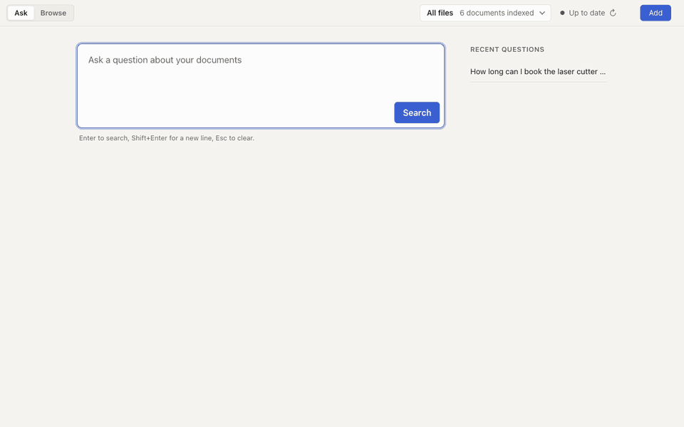
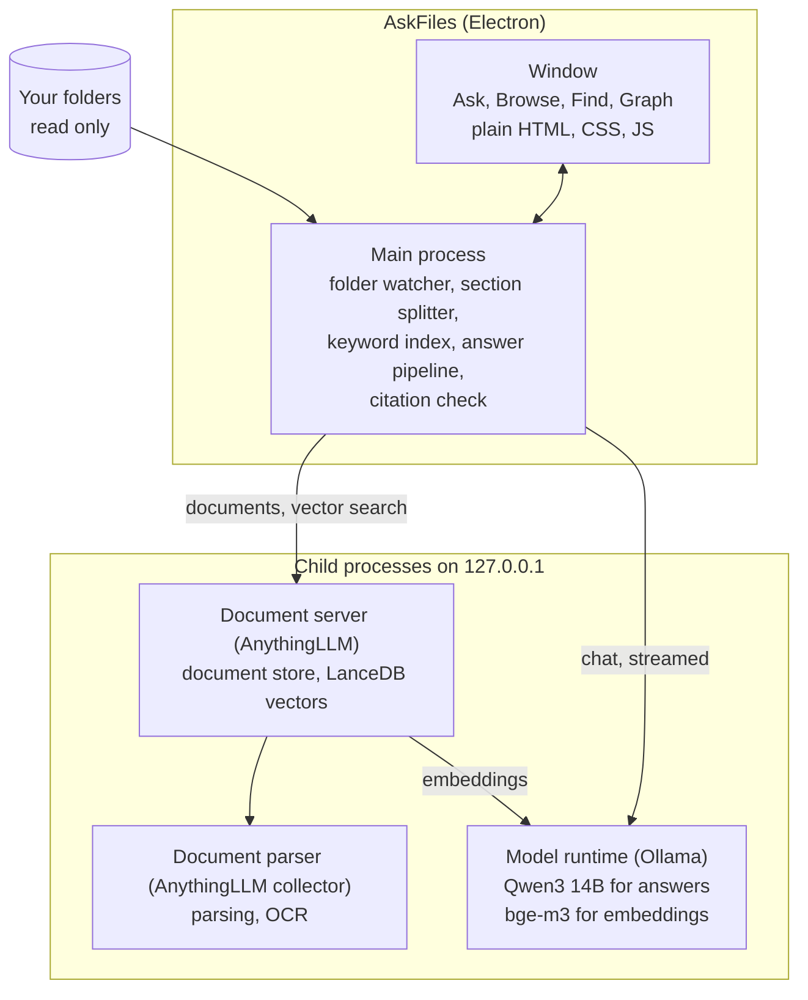

# AskFiles

**Ask questions about your own documents and get answers that cite the file, section and page, with everything running on your own computer.**

| Browse: Compare | Browse: Library |
|---|---|
|  |  |

The screenshots show an invented demo library.

**What makes it different**

- **Fully local.** The language model, the embeddings, the search index and text recognition all run on the machine. Documents and questions never leave it; there is no account, no telemetry, and after the first model download no internet connection is needed.
- **Answers with checked sources.** Every sentence of an answer is checked against the passage it cites. A citation that does not hold moves to a source that supports the sentence, or is removed.
- **Unsupported sentences are marked.** A sentence that no source supports keeps its place in the answer but gets a dagger (†), so the reader knows exactly which part to verify. When the documents do not contain the answer, AskFiles says so and lists the closest sections instead of guessing.

**[Download v1.0.0](https://github.com/yuan-phd/askfiles/releases/tag/v1.0.0)**: `AskFiles-1.0.0-arm64.dmg` for macOS, `AskFiles-1.0.0-x64-setup.exe` for Windows.

## System requirements

- **Mac**: Apple silicon (M1 or later), macOS 14 (Sonoma) or later. There is no build for Intel Macs.
- **Windows**: Windows 10 (version 22H2 or newer) or Windows 11, x64.
- At least 15 GB of free disk space, and an internet connection for the first start, which downloads the models.

| Memory | What you get | First download |
|---|---|---|
| 32 GB or more | Ask, Browse and Find, with Qwen3 14B (4-bit) | about 10.4 GB |
| 16 GB | Ask, Browse and Find, with Qwen3 14B (3-bit) | about 8.5 GB |
| 8 GB | Browse and Find only; Ask needs 16 GB | about 1.2 GB |

## How accurate is it?

Measured on two evaluation sets of public procurement documents, 12 in English and 15 in Chinese, on a Mac with 64 GB of memory. Results on other documents may differ. Questions that compare two documents are reported in two rows, because the result depends on how the question refers to the documents:

| Question type | Right sources cited | Answer complete |
|---|---|---|
| Compare two documents, **question names both files** | 9 of 10 | 8 of 10 |
| Compare two documents, **question only describes them** (sealed holdout set) | 2 of 8 | 3 of 8 |
| About one document (graded by hand) | | English 32 of 36, Chinese 19 of 20 |
| No answer in the documents | | said so in 21 of 21, made nothing up |

An answer takes about 14 seconds in English and 7 in Chinese; a question naming two documents takes about 76 seconds. [The case study](docs/case-study-cross-document.md) explains how these figures were measured, what was tried, and why the second row is so much lower than the first.

## Architecture

AskFiles is an Electron app. Its main process starts three local processes, all bound to 127.0.0.1, and owns the retrieval and answer pipeline itself:

- [AnythingLLM](https://github.com/Mintplex-Labs/anything-llm) v1.19.0 (MIT) is vendored in [upstream/](upstream/) and used headless as the document store, parser, OCR, embedder and vector database. It is never edited: eight small patches in [patches/](patches/) are applied to a copy at build time, for example to bind to 127.0.0.1 and to stop requests made at startup.
- [Ollama](https://ollama.com/) is bundled in the app, with its cloud features off. The model is chosen from the machine's memory; the user never picks one.
- The shell splits documents itself, by section, so every source card can name a section and page: PDF bookmarks or font sizes, Word heading styles, Markdown headings, one section per spreadsheet sheet or slide.

## How retrieval and citation checking work

1. **Split by section, not by length.** Each section is one unit. A long section is cut into chunks of at most 2,000 characters that all carry the section's title, and hits from the same section are merged back into one.
2. **Two searches, one ranking.** Vector search (bge-m3) and a BM25 keyword index over the sections each return 30 candidates; reciprocal rank fusion merges them into a single ranked list of sections. Keyword search catches exact terms, codes and names that vector search misses.
3. **Select whole sections.** The default scope reads the best 5 sections above a similarity floor, within an 8,192-token context. When the question names two or more files, each named file is also searched on its own and contributes its best sections, so one document cannot crowd out the other. There is no cross-encoder reranker: onnxruntime crashed on the test Mac when one loaded, so sections stay in fused order.
4. **Answer from numbered sources.** The model (Qwen3 14B, thinking off) sees numbered sources without file names or pages and must cite `[n]`, or reply that the sources do not state the answer. Source cards are built from the shell's own section records, never from the model's text.
5. **Check every sentence.** After the reply, each sentence is compared with the passage it cites: the share of its content words (English by stem, Chinese by character pairs) found there. A sentence at or above the threshold keeps its citation; below it, the citation moves to a selected source that does reach it; otherwise the citation is removed and the sentence is marked †. An unsupported sentence that only says some information is missing is dropped when supported sentences remain.

The section summaries in Browse go through the same check, and an unsupported summary is not shown. [docs/app.md](docs/app.md) describes the pipeline step by step; [docs/eval.md](docs/eval.md) describes the evaluation harness and every switch that was measured.

## Install

Download the file for your system from the [v1.0.0 release](https://github.com/yuan-phd/askfiles/releases/tag/v1.0.0). The builds are not code-signed, so the system warns the first time:

- **macOS**: open the `.dmg` and drag AskFiles to Applications. If macOS says it cannot verify the app, open System Settings, Privacy & Security, and click **Open Anyway**. Work computers managed by an organisation may block unsigned apps entirely.
- **Windows**: run the installer. If SmartScreen appears, click **More info**, then **Run anyway**.

On first start, AskFiles checks the computer's memory, downloads the matching models and opens. Add a folder or some files, wait for indexing to finish, and ask. The [user guide](docs/user-guide.md) covers the rest, including what AskFiles does not do well.

## Building from source

Node 22 and, for the evaluation harness, Ollama. `npm install`, then `npm run dev`, which builds the patched upstream copy and starts the app; `npm test` runs the unit tests. Packaging is described in [docs/packaging.md](docs/packaging.md) (macOS) and [docs/windows.md](docs/windows.md) (Windows), the project plan and its decisions in [docs/plan.md](docs/plan.md).

## Feedback

Please open an [issue](https://github.com/yuan-phd/askfiles/issues) with what you asked, what you expected and what happened. Do not paste content from confidential documents.

## License

Copyright 2026 yuan-phd.

AskFiles is licensed under the [Apache License 2.0](LICENSE). The AnythingLLM core in [upstream/](upstream/) is MIT-licensed ([upstream/LICENSE](upstream/LICENSE)). Third-party components keep their own licenses, listed in [THIRD-PARTY-NOTICES](THIRD-PARTY-NOTICES). Contributions: see [CONTRIBUTING.md](CONTRIBUTING.md).
