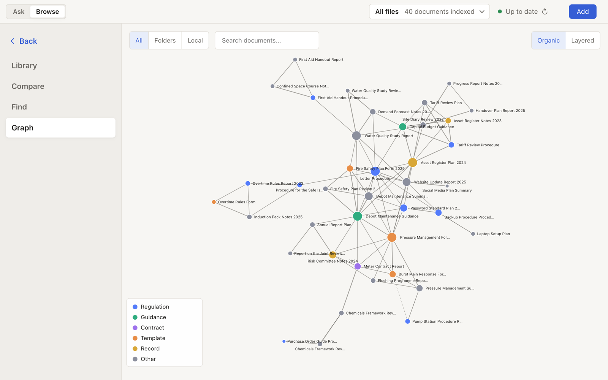
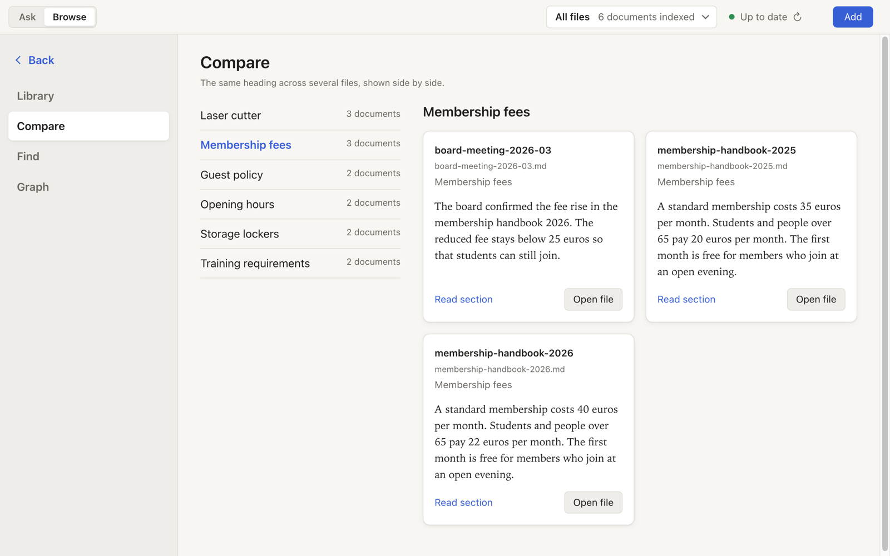
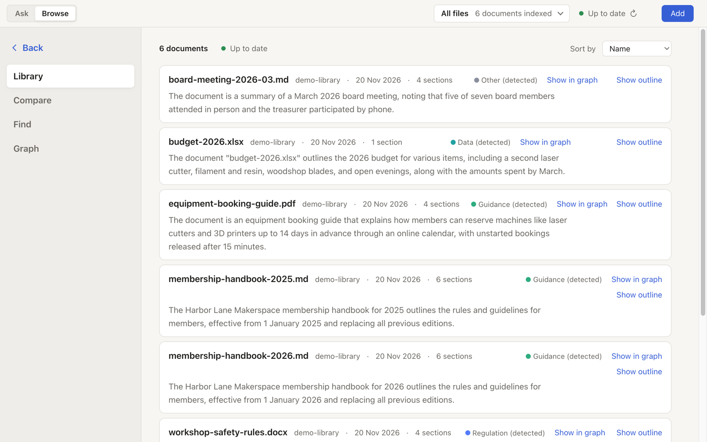
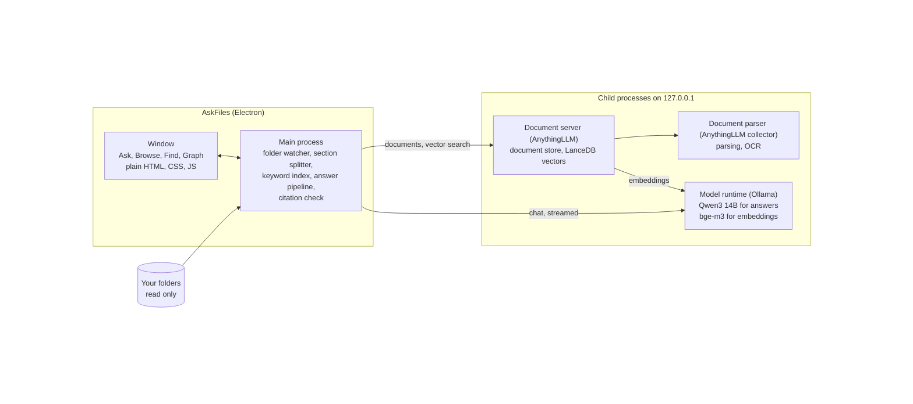

# AskFiles

Ask your documents. Every sentence checked against the passage it cites.

**Ask questions about your own documents and get answers that cite the file, section and page, with everything running on your own computer.**

[](https://github.com/yuan-phd/askfiles/releases/latest)
[](LICENSE)
[](#install)
[](https://github.com/yuan-phd/askfiles/actions/workflows/mac.yml)
[](https://github.com/yuan-phd/askfiles/actions/workflows/windows.yml)

**[Download v1.0.0](https://github.com/yuan-phd/askfiles/releases/tag/v1.0.0)**: `AskFiles-1.0.0-arm64.dmg` for macOS, `AskFiles-1.0.0-x64-setup.exe` for Windows. Official builds are published only on this repository's [Releases](https://github.com/yuan-phd/askfiles/releases) page, with SHA-256 checksums in the release notes.

Measured: questions about one document answered completely in English 32 of 36 and Chinese 19 of 20 (graded by hand); questions with no answer in the documents: said so in 21 of 21. Questions that compare two documents are weaker; see [How accurate is it?](#how-accurate-is-it)


**What makes it different**

- **Fully local.** The language model, the embeddings, the search index and text recognition all run on the machine. Documents and questions never leave it; there is no account, no telemetry, and after the first model download no internet connection is needed.
- **Answers with checked sources.** Every sentence of an answer is checked against the passage it cites. A citation that does not hold moves to a source that supports the sentence, or is removed.
- **Unsupported sentences are marked.** A sentence that no source supports keeps its place in the answer but gets a dagger (†), so the reader knows exactly which part to verify. When the documents do not contain the answer, AskFiles says so and lists the closest sections instead of guessing.

## Install

- **Mac**: Apple silicon (M1 or later), macOS 14 (Sonoma) or later. There is no build for Intel Macs.
- **Windows**: Windows 10 (version 22H2 or newer) or Windows 11, x64.
- At least 15 GB of free disk space, and an internet connection for the first start, which downloads the models.

| Memory        | What you get                                 | First download |
| ------------- | -------------------------------------------- | -------------- |
| 32 GB or more | Ask, Browse and Find, with Qwen3 14B (4-bit) | about 10.4 GB  |
| 16 GB         | Ask, Browse and Find, with Qwen3 14B (3-bit) | about 8.5 GB   |
| 8 GB          | Browse and Find only; Ask needs 16 GB        | about 1.2 GB   |

Download the file for your system from the [v1.0.0 release](https://github.com/yuan-phd/askfiles/releases/tag/v1.0.0). The builds are not code-signed with a developer certificate (the Mac app is signed ad hoc only, as the project has no Apple Developer account), so the system warns the first time:

- **macOS**: open the `.dmg` and drag AskFiles to Applications. If macOS says it cannot verify the app, open System Settings, Privacy & Security, and click **Open Anyway**. Work computers managed by an organisation may block unsigned apps entirely.
- **Windows**: run the installer. If SmartScreen appears, click **More info**, then **Run anyway**.

On first start, AskFiles checks the computer's memory, downloads the matching models and opens. Add a folder or some files, wait for indexing to finish, and ask. The [user guide](docs/user-guide.md) covers the rest, including what AskFiles does not do well.

## What it does

| Page    | What it is for                                                                                                                |
| ------- | ----------------------------------------------------------------------------------------------------------------------------- |
| Ask     | Type a question; the answer cites its sources by number, and each source card shows the file, section and page.              |
| Library | Every document, with its outline, its type and a one-sentence summary checked against its text.                              |
| Compare | The same heading across several files, side by side.                                                                          |
| Find    | Words and phrases in your documents, without a model.                                                                         |
| Graph   | A map of the library: documents that share headings, mention each other, or are versions or copies of one document are linked. |

Supported files: PDF, Word (.docx), Excel (.xlsx, .xlsm, .xls), PowerPoint (.pptx), Markdown (.md, .markdown) and text (.txt).



Browse: Graph. Each dot is a document, coloured by its type; lines link documents that share headings, mention each other, or are versions of one document.

| Browse: Compare                                                                  | Browse: Library                                                                                              |
| -------------------------------------------------------------------------------- | ------------------------------------------------------------------------------------------------------------ |
|  |  |

The screenshots show an invented demo library.

## How accurate is it?

Measured on two evaluation sets of public procurement documents, 12 in English and 15 in Chinese, on a Mac with 64 GB of memory. Results on other documents may differ. Questions that compare two documents are reported in two rows, because the result depends on how the question refers to the documents:

| Question type                                                                | Right sources cited | Answer complete                    |
| ---------------------------------------------------------------------------- | ------------------- | ---------------------------------- |
| Compare two documents, **question names both files**                         | 9 of 10             | 8 of 10                            |
| Compare two documents, **question only describes them** (sealed holdout set) | 2 of 8              | 3 of 8                             |
| About one document (graded by hand)                                          |                     | English 32 of 36, Chinese 19 of 20 |
| No answer in the documents                                                   |                     | said so in 21 of 21, made nothing up |

An answer takes about 14 seconds in English and 7 in Chinese; a question naming two documents takes about 76 seconds. [The case study](docs/case-study-cross-document.md) explains how these figures were measured, what was tried, and why the second row is so much lower than the first.

## Privacy

- The document server, the document parser and the model runtime (Ollama) listen on 127.0.0.1 only, so nothing on the network can reach them.
- Your files are read, never changed. Linked folders are watched, not written to.
- No account and no telemetry.
- After the first model download, AskFiles works offline: only model downloads use the internet, never indexing or answering.
- Ollama's cloud features are off: no cloud models, no web search, no calls to ollama.com at start.

To check this yourself, disconnect from the network after the first start and ask a question: the answer still comes.

## Known limits

- **Arithmetic on tables can be wrong.** Check numbers it works out against the table itself.
- **Comparing documents works best when you name both files.** Asking about each document separately is more reliable still.
- **Poor-quality scans may be misread**, and **spreadsheet formulas are not read**, only the values in the cells.
- **On computers with 8 GB of memory, Ask is off.** Browse, Find and the Graph work there.
- **No Intel Mac or Linux build.** Releases are for Apple silicon Macs and Windows x64.

More in the [user guide](docs/user-guide.md#what-it-cannot-do-well).

## How it works

AskFiles is an Electron app. Its main process starts three local processes, all bound to 127.0.0.1, and owns the retrieval and answer pipeline itself:



- [AnythingLLM](https://github.com/Mintplex-Labs/anything-llm) v1.19.0 (MIT) is vendored in [upstream/](upstream/) and used headless as the document store, parser, OCR, embedder and vector database. It is never edited: eight small patches in [patches/](patches/) are applied to a copy at build time, for example to bind to 127.0.0.1 and to stop requests made at startup.
- [Ollama](https://ollama.com/) is bundled in the app, with its cloud features off. The model is chosen from the machine's memory. Settings offers Better, the default, and on 32 GB or more also Faster, the 16 GB model (Qwen3 14B, 3-bit), which answers sooner.
- The shell splits documents itself, by section, so every source card can name a section and page: PDF bookmarks or font sizes, Word heading styles, Markdown headings, one section per spreadsheet sheet or slide.

How a question is answered:

1. **Split by section, not by length.** Long sections are cut into chunks that carry the section's title; hits from one section merge back into it.
2. **Two searches, one ranking.** Vector search (bge-m3) and a BM25 keyword index each return candidates; reciprocal rank fusion merges them into one ranked list of sections.
3. **Select whole sections.** The best sections above a similarity floor fill the context; a question naming several files also gets sections from each named file.
4. **Answer from numbered sources.** Qwen3 14B, thinking off, must cite `[n]` or say the sources do not state the answer; source cards come from the shell's section records.
5. **Check every sentence.** Each sentence is compared with the passage it cites; a citation that fails moves to a source that holds, or is removed and the sentence marked †.

The section summaries in Browse go through the same check, and an unsupported summary is not shown. [docs/app.md](docs/app.md) describes the pipeline step by step, with its candidate counts, chunk size and context length; [docs/eval.md](docs/eval.md) describes the evaluation harness and every switch that was measured.

## Documentation

| Goal                        | Read                                                                                                                                                                 |
| --------------------------- | -------------------------------------------------------------------------------------------------------------------------------------------------------------------- |
| Use the app                 | [User guide](docs/user-guide.md), [Windows](docs/windows.md)                                                                                                         |
| Understand how it works     | [App and answer pipeline](docs/app.md), [Graph](docs/graph.md), [Summaries](docs/summaries.md), [Presets](docs/presets.md), [Upstream analysis](docs/upstream-analysis.md) |
| See how it was measured     | [Case study](docs/case-study-cross-document.md), [Evaluation harness](docs/eval.md)                                                                                  |
| Build and package it        | [macOS packaging](docs/packaging.md), [Windows build](docs/windows.md), [Bundle report](docs/bundle-report.md)                                                       |

All documents are listed in the [docs index](docs/README.md).

## FAQ

<details><summary>Why does Ask need 16 GB of memory?</summary>

Answers were measured acceptable only with Qwen3 14B, which needs 16 GB. A smaller 8B model already cited the right sources less often and was worse at saying when the documents hold no answer. On 8 GB, Browse, Find and the Graph still work.

</details>

<details><summary>Can I choose my own model?</summary>

The model is chosen from the machine's memory. Settings offers Better, the default, and on 32 GB or more also Faster, the 16 GB model (Qwen3 14B, 3-bit), which answers sooner.

</details>

<details><summary>Does it need the internet?</summary>

Only to download the models on the first start, or when you switch to a model that is not installed yet. Indexing and answering need no connection.

</details>

<details><summary>Where is my data stored, and how do I remove everything?</summary>

On macOS, libraries, index, settings and models are in `~/Library/Application Support/AskFiles` and the logs in `~/Library/Logs/AskFiles`; to remove everything, quit AskFiles, move it from Applications to the Trash and delete both folders. On Windows, everything is in `%LOCALAPPDATA%\AskFiles`; uninstall in Settings > Apps > Installed apps, which keeps that folder, then delete it by hand. Your own files stay where they are and are never changed.

</details>

<details><summary>Why does the system warn on first launch?</summary>

The builds are not signed with a developer certificate, so macOS Gatekeeper and Windows SmartScreen cannot verify them. Allow the first launch as described under [Install](#install).

</details>

<details><summary>Is there an Intel Mac or Linux version?</summary>

No. Releases are built for Apple silicon Macs and for Windows x64 only.

</details>

<details><summary>How does it relate to AnythingLLM?</summary>

AskFiles uses AnythingLLM v1.19.0, unedited apart from eight small build-time patches, as a headless backend: document store, parser, OCR, embedder and vector database. The window, the section splitting, retrieval, answering and citation checking are AskFiles's own.

</details>

## Building from source

Node 22 and, for the evaluation harness, Ollama.

```bash
npm install
npm run dev   # builds the patched upstream copy and starts the app
npm test      # unit tests
```

Packaging is described in [docs/packaging.md](docs/packaging.md) (macOS) and [docs/windows.md](docs/windows.md) (Windows), the project plan and its decisions in [docs/plan.md](docs/plan.md).

## Feedback

Please open an [issue](https://github.com/yuan-phd/askfiles/issues) with what you asked, what you expected and what happened. Do not paste content from confidential documents.

## License

Copyright 2026 yuan-phd.

AskFiles is licensed under the [Apache License 2.0](LICENSE). The AnythingLLM core in [upstream/](upstream/) is MIT-licensed ([upstream/LICENSE](upstream/LICENSE)). Third-party components keep their own licenses, listed in [THIRD-PARTY-NOTICES](THIRD-PARTY-NOTICES). Contributions: see [CONTRIBUTING.md](CONTRIBUTING.md).
